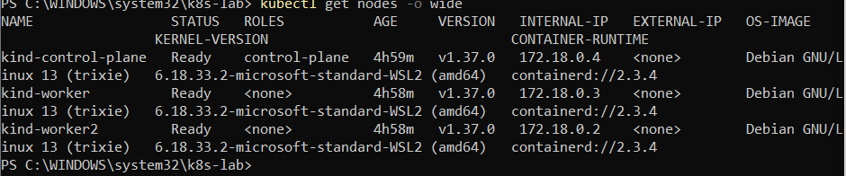
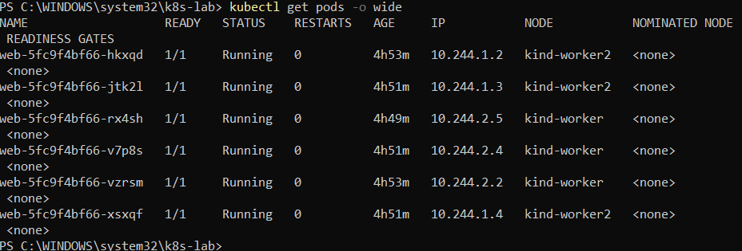
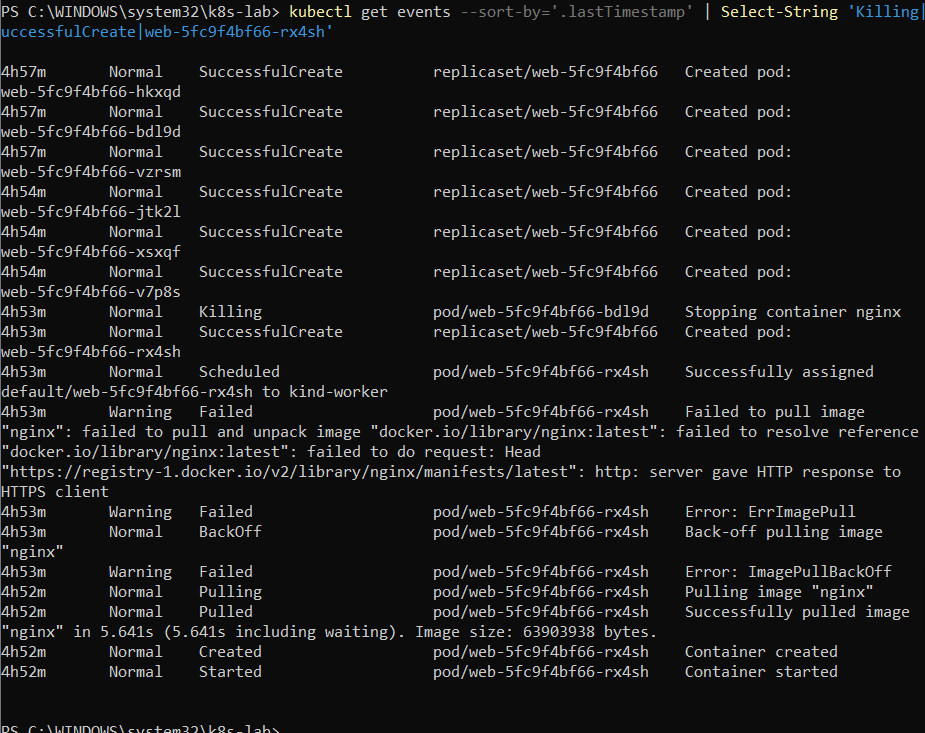

# Kubernetes Lab on Windows Using kind


## Aim

To create a local Kubernetes cluster on Windows using Docker Desktop and kind, deploy an NGINX application, scale the deployment, and demonstrate Kubernetes self-healing.


## Tools and Technologies

\- Windows PowerShell

\- Docker Desktop

\- Kubernetes (`kubectl`)

\- kind (Kubernetes IN Docker)

\- NGINX

\- Git and GitHub


## Cluster Architecture

The Kubernetes cluster contains:

\- 1 control-plane node

\- 2 worker nodes


Configuration file: `kind-config.yaml`


```yaml

kind: Cluster

apiVersion: kind.x-k8s.io/v1alpha4

nodes:

&#x20; - role: control-plane

&#x20; - role: worker

&#x20; - role: worker

```


## Procedure


### 1. Verify the tools

```powershell

docker version

docker run hello-world

kubectl version --client

kind version

```


### 2. Create the Kubernetes cluster

```powershell

kind create cluster --config kind-config.yaml

kubectl cluster-info --context kind-kind

kubectl get nodes

```


### 3. Verify the cluster

```powershell

docker ps

kubectl get pods -n kube-system -o wide

```


All three Kubernetes nodes reached the `Ready` state.


### 4. Deploy NGINX with three replicas

```powershell

kubectl create deployment web --image=nginx --replicas=3

kubectl get deployments

kubectl get pods -o wide

```


The deployment reached `3/3` ready replicas.


### 5. Scale the deployment to six replicas

```powershell

kubectl scale deployment web --replicas=6

kubectl get pods -o wide

```


All six NGINX Pods reached the `Running` state.


### 6. Demonstrate self-healing

Delete one Pod using its actual name:

```powershell

kubectl delete pod <pod-name>

kubectl get pods

```


Kubernetes automatically created a replacement Pod to maintain the desired replica count of six.


## Cleanup

To delete the local kind cluster after the lab, run:

```powershell

kind delete cluster

```


Run the cleanup command only when the cluster is no longer needed.

## Screenshots


### 1. Kubernetes Cluster Nodes





### 2. NGINX Deployment with Six Pods





### 3. Kubernetes Self-Healing





## Graph: Deployment Scaling and Self-Healing


The deployment was scaled from 3 replicas to 6 replicas. After a pod was deleted, Kubernetes created a replacement pod to maintain the desired replica count.


```mermaid

xychart-beta

&#x20;   title "NGINX Replica Count"

&#x20;   x-axis ["Initial", "Scaled", "After Self-Healing"]

&#x20;   y-axis "Replicas" 0 --> 6

&#x20;   bar [3, 6, 6]

```

## Results

- Successfully created a local Kubernetes cluster using kind on Windows.
- Verified that the control-plane node and both worker nodes were in the Ready state.
- Deployed the NGINX application using a Kubernetes Deployment.
- Scaled the NGINX Deployment from 3 replicas to 6 replicas.
- Deleted a running Pod and verified that Kubernetes automatically created a replacement Pod.
- Confirmed that six Pods were running after self-healing.
- Captured screenshots of the cluster nodes, six NGINX Pods, and self-healing process.

## Conclusion

The experiment demonstrated the basic features of Kubernetes using kind on Windows. The NGINX application was deployed and scaled successfully, and Kubernetes self-healing was verified by deleting a Pod and observing its replacement. The experiment provided practical experience with cluster management, replica scaling, and automatic recovery.

## Author

**Name:** Vandana

**GitHub:** [Vandana-45](https://github.com/Vandana-45)

**Repository:** [Kubernetes Lab on Windows](https://github.com/Vandana-45/Kubernetes-Lab-on-Windows)


